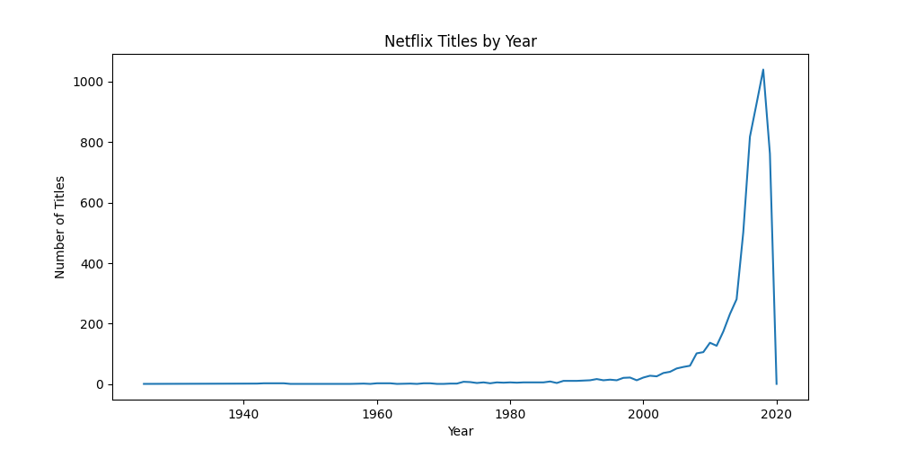
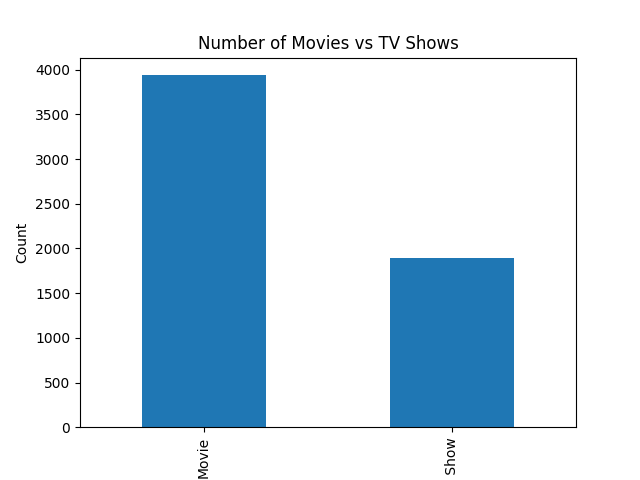
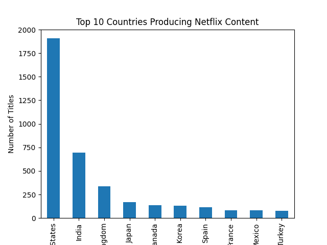

# Netflix Data Analysis

This project analyzes Netflix Movies and TV Shows dataset using Python.

## Tools
- Python
- Pandas
- Matplotlib

## Analysis
1. Netflix titles by release year
2. Movies vs TV Shows distribution
3. Top 10 countries producing Netflix content

## Visualizations

## Dataset
Netflix Titles Dataset (2019)

## Output
Charts are generated and saved in the images folder.
